# Nexvia Sentinel — Platform Architecture & Engineering Specification

## 1. System Architecture Map

The diagram below reflects the **actual current implementation state** of the Sentinel platform, strictly distinguishing active production paths, isolated offline components, mock-tested modules, and unverified deployment targets.

```mermaid
flowchart TD
    %% Subgraphs
    subgraph S1["1. Active Production Inference & Serving Path (Live Deployed)"]
        A1["Analyst / Client Request"] -->|"HTTP POST /api/v1/predict/fraud"| B1["FastAPI Application (Render)"]
        UI1["React + Vite Analyst Dashboard (Vercel)"] -->|"REST /api/v1/*"| B1

        B1 --> C1["SentinelFeaturePipeline (20 Pre-Auth Features)"]
        C1 --> D1["XGBoost Tabular Model (scale_pos_weight=35.94)"]
        C1 --> E1["PyTorch Geometric GraphSAGE (In-Memory Snapshot: 763k nodes)"]

        D1 -->|"P_XGB"| F1["Hybrid Risk Ensemble & Platt Calibrators"]
        E1 -->|"P_GNN"| F1

        F1 -->|"Composite Risk & Route"| G1["4-Tier Decision Engine (CRITICAL / HIGH / MEDIUM / LOW)"]
        G1 -->|"Log Transaction & Alert"| H1[("SQLite Ledger DB (sentinel_ledger.db)")]
        UI1 -->|"Feedback Triage (CONFIRMED_FRAUD / FALSE_POSITIVE)"| H1
    end

    subgraph S2["2. Offline ML Training & Experiment Tracking (Verified Locally)"]
        T1["PaySim Dataset (train_benchmark_sample.parquet / val.parquet)"] --> T2["XGBoost Training Pipeline (train_xgboost.py)"]
        T1 --> T3["GraphSAGE Training Pipeline (train_gnn.py)"]
        T2 -->|"Model Weights"| D1
        T3 -->|"Model Weights"| E1
        T2 -->|"Log Parameters, Metrics, Artifacts"| M1[("MLflow Tracking Store (sqlite:///mlruns.db)")]
    end

    subgraph S3["3. Evidently Drift Monitoring & Retraining Gate (Verified Locally)"]
        D_REF["Reference Data (val.parquet)"] --> MON["Evidently Drift Monitor (drift_monitor.py)"]
        D_CURR["Current Serving Batch / Replay"] --> MON
        MON -->|"Kolmogorov-Smirnov Test"| REP["HTML & JSON Drift Reports (monitoring_reports/)"]
        REP -->|"Drift > 0.30"| GATE{"Human Retraining Gate"}
        GATE -->|"Authorized by Analyst"| RETRAIN["Trigger Model Retraining"]
        GATE -.->|"Safety Blocked"| SEC["Prevents Unauthorized Auto-Execution"]
    end

    subgraph S4["4. Feast Feature Store (Verified in Isolated Sandbox - NOT Active in Inference)"]
        SRC_P["Source Parquet (feature_store/data/account_features.parquet)"] --> F_OFF["Feast File Offline Store"]
        F_OFF -->|"store.get_historical_features (Point-in-Time Join)"| F_HIST["Historical Dataset (Zero Future Leakage)"]
        F_OFF -->|"store.materialize"| F_ON[("Feast Online Store (sqlite:///online_store.db)")]
        F_ON -->|"store.get_online_features"| F_LIVE["5 Rolling Account Features (NOT Wired to Production API)"]
    end

    subgraph S5["5. Streaming Backbone (Mock-Tested Only - Real Broker UNVERIFIED)"]
        KP["Kafka Producer (kafka_producer.py)"] -.->|"sentinel.transactions"| KB[["Apache Kafka KRaft Broker (docker-compose)"]]
        KB -.->|"Consume"| KC["FastAPI Consumer Worker (kafka_consumer.py)"]
        KC -.->|"DLQ on Failure"| DLQ[["sentinel.transactions.dlq"]]
        NOTE_K["Status: Tested via in-memory mocks.\nReal-broker end-to-end streaming UNVERIFIED."]
    end

    subgraph S6["6. Kubernetes / Minikube Target (Statically Validated - Cluster Deployment UNVERIFIED)"]
        K8S_C["ConfigMap (sentinel-config)"] --> K8S_D["Deployment: sentinel-backend (1 Replica, Recreate)"]
        K8S_P["PVC (sentinel-backend-pvc 1Gi RWO)"] --> K8S_D
        K8S_D --> K8S_S["Service: sentinel-backend (ClusterIP :8000)"]
        K8S_FD["Deployment: sentinel-frontend (Nginx Alpine)"] --> K8S_FS["Service: sentinel-frontend (NodePort :30080)"]
        K8S_FD -.->|"Reverse-Proxy /api/"| K8S_S
        NOTE_K8S["Status: 7 manifests validated via pytest.\nCluster deployment UNVERIFIED (No Docker/Minikube on host)."]
    end

    %% Stylings
    style S1 fill:#0f172a,stroke:#38bdf8,stroke-width:2px,color:#f8fafc
    style S2 fill:#1e1b4b,stroke:#818cf8,stroke-width:2px,color:#f8fafc
    style S3 fill:#14532d,stroke:#4ade80,stroke-width:2px,color:#f8fafc
    style S4 fill:#451a03,stroke:#fb923c,stroke-width:2px,color:#f8fafc
    style S5 fill:#3b0764,stroke:#c084fc,stroke-width:2px,stroke-dasharray: 5 5,color:#f8fafc
    style S6 fill:#312e81,stroke:#6366f1,stroke-width:2px,stroke-dasharray: 5 5,color:#f8fafc
```

---

## 2. Subsystem Verification & Implementation Status

| Subsystem | Components | Implementation Status | Verification Evidence |
| :--- | :--- | :--- | :--- |
| **Tabular Scoring** | `SentinelFeaturePipeline`, `xgboost_baseline.json` | **Implemented & Deployed** | 20 pre-auth features, test holdout PR-AUC: `0.9993`, evaluated on 90,829 transactions. Live on Render. |
| **Relational GNN** | `SentinelGraphSAGE`, `gnn_graphsage.pt` | **Implemented & Deployed** | In-memory graph snapshot (`763,788` nodes, `415,395` edges), test holdout ROC-AUC: `0.9039`, PR-AUC: `0.4448`. |
| **Hybrid Ensemble** | Platt calibrators, 4-tier decision routing | **Implemented & Deployed** | Weighted calibration ($\alpha=0.78, 1-\alpha=0.22$), automated alert generation and triage persistence. |
| **API & Dashboard** | FastAPI, SQLite Ledger, React UI | **Implemented & Deployed** | Live at `https://nexvia-sentinel.onrender.com` (backend) & `https://nexvia-sentinel.vercel.app` (frontend). |
| **Experiment Tracking** | MLflow (`mlruns.db`, `train_xgboost.py`) | **Implemented & Tested** | SQLite backend tracking parameters, PR-AUC, ROC-AUC, and model artifacts (`test_mlflow_tracking.py`). |
| **Drift Monitoring** | Evidently AI (`drift_monitor.py`) | **Implemented & Tested** | Kolmogorov-Smirnov drift detection with HTML/JSON reports and safety-gated retraining trigger (`test_drift_monitoring.py`). |
| **Feature Store** | Feast (`feature_store/`) | **Implemented in Isolated Sandbox** | Offline Parquet point-in-time join, SQLite materialization, online lookup (`test_feast_feature_store.py`). **Not active in production inference**. |
| **Event Streaming** | Kafka Producer/Consumer (`docker-compose.yml`) | **Mock-Tested Only** | Python logic implemented and tested with mock brokers; **unverified on live real-broker cluster**. |
| **Kubernetes Target** | Manifests (`k8s/`), Nginx frontend | **Statically Validated Only** | 7 manifests validated via `test_kubernetes_manifests.py`. **Cluster deployment unverified** due to lack of local Minikube/Docker. |

---

## 3. Production Limitations & Design Decisions

### 3.1 Single-Replica SQLite Persistence
- **Constraint**: SQLite is a file-based embedded database requiring `ReadWriteOnce` storage.
- **Limitation**: Multiple replicas mounting the same SQLite file simultaneously fail with `sqlite3.OperationalError: database is locked`.
- **Target Architecture**: In multi-replica cloud clusters, the SQLite ledger must be migrated to a managed PostgreSQL instance (e.g. AWS RDS or Cloud SQL).

### 3.2 In-Memory Graph Memory Constraints
- **Constraint**: PyTorch Geometric inductive GraphSAGE maintains node embeddings and graph edges in process memory.
- **Limitation**: The current PaySim snapshot requires ~390MB memory for 763k nodes. At 100M+ accounts, in-memory graph representation exceeds single-node RAM budgets.
- **Target Architecture**: A distributed graph store (Neo4j, Amazon Neptune, or TigerGraph) with sub-graph neighborhood sampling should be introduced for large-scale enterprise scaling.

### 3.3 Isolated Feast Feature View
- **Constraint**: The active production model (`xgboost_baseline.json`) expects strictly the 20 pre-auth features emitted by `SentinelFeaturePipeline`.
- **Limitation**: The 5 Feast rolling features (`rolling_avg_amount_24h`, etc.) are maintained in an isolated sandbox (`feature_store/`). Injecting Feast directly into live inference without retraining would cause model input dimension mismatch (25 vs 20 features).
- **Target Architecture**: The offline model training pipeline should be retrained on combined features, followed by Feast online client integration into `inference_service.py`.
