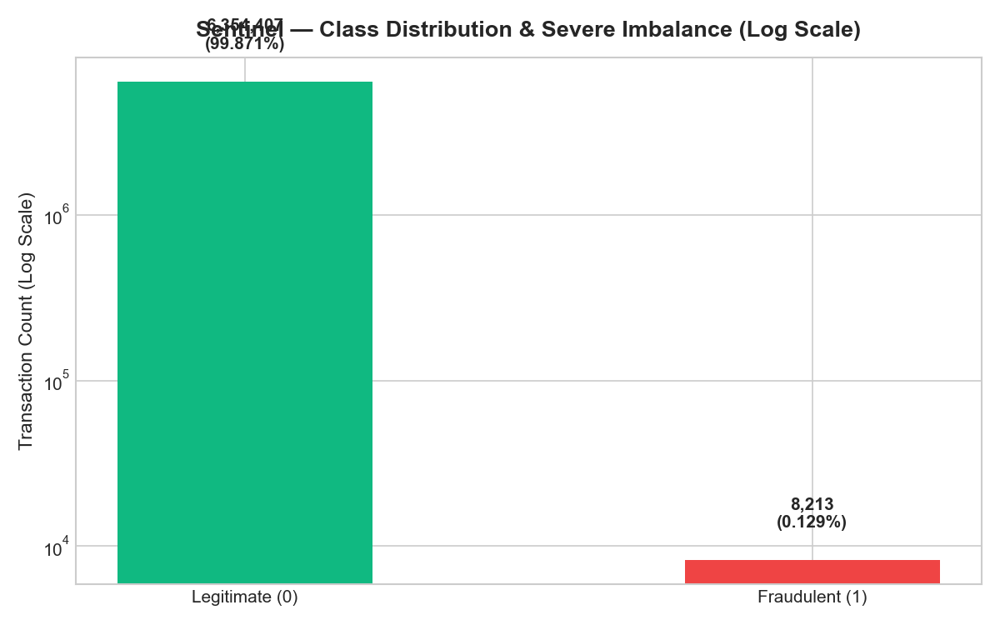
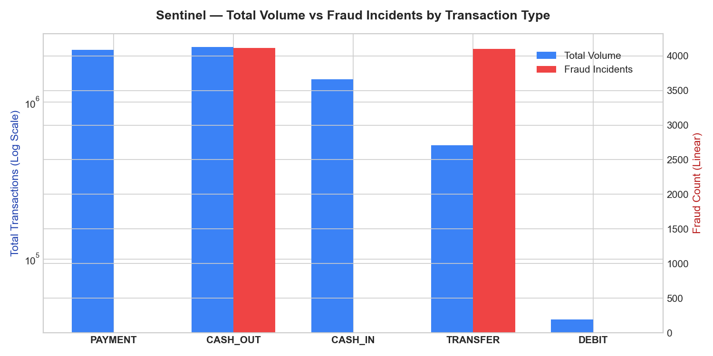
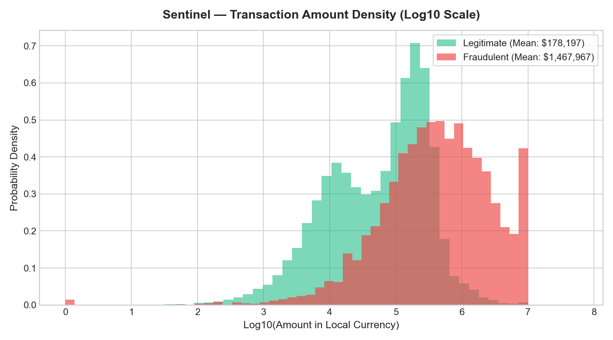
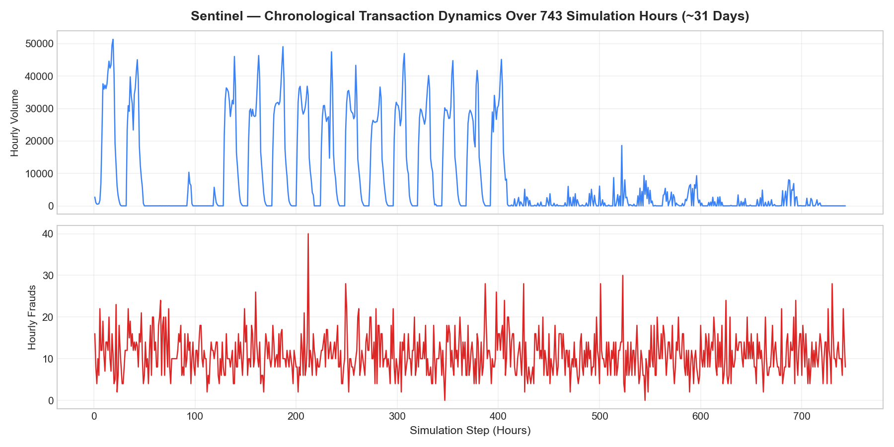
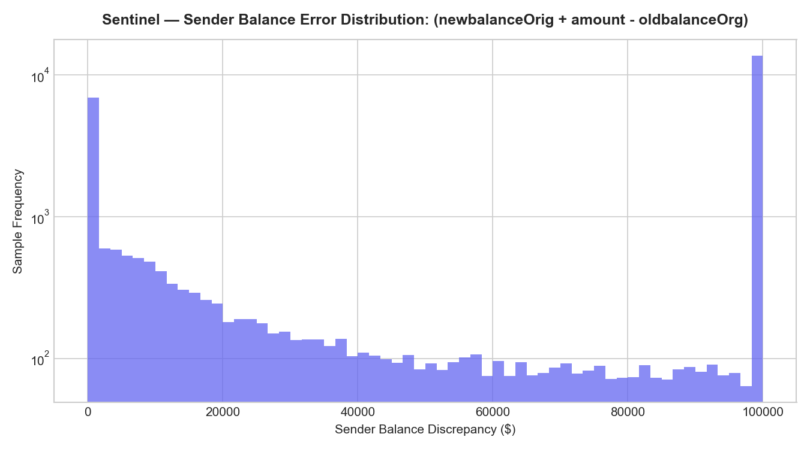
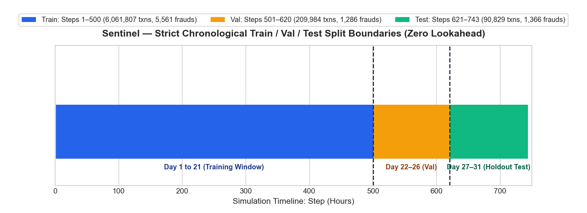

# Sentinel — Exploratory Data Analysis & Data Quality Report

## 1. Dataset Provenance & Overview
- **Dataset:** PaySim Synthetic Financial Datasets For Fraud Detection
- **Source:** Lopez-Rojas et al. (2016), hosted on Kaggle (`ealaxi/paysim1`)
- **Licensing:** CC BY-SA 4.0
- **Total Transactions Analyzed:** 6,362,620
- **Total Columns:** 11
- **Data Quality / Missing Values:** Complete completeness; zero null values across all 6,362,620 rows.

---

## 2. Target Distribution & Severe Class Imbalance
- **Legitimate Transactions (isFraud = 0):** 6,354,407 (99.8709%)
- **Fraudulent Transactions (isFraud = 1):** 8,213 (0.1291%)
- **Imbalance Ratio:** 1 fraud per 774 transactions
- **Key Implication:** Standard accuracy is a deceptive metric (a naive model predicting 0 achieves 99.87% accuracy). Optimization and evaluation must focus strictly on **Precision-Recall AUC (PR-AUC)**, **Recall at 95% Precision**, and **Cost-Utility curves**.

---

## 3. Transaction Types & Fraud Concentration
PaySim models five distinct financial operations. However, fraud is strictly isolated to only two:

| Transaction Type | Total Count | % of Total | Fraud Incidents | Fraud Rate (%) |
| :--- | :--- | :--- | :--- | :--- |
| **PAYMENT** | 2,151,495 | 33.81% | 0 | 0.0000% |
| **CASH_OUT** | 2,237,500 | 35.17% | 4,116 | 0.184% |
| **CASH_IN** | 1,399,284 | 21.99% | 0 | 0.0000% |
| **TRANSFER** | 532,909 | 8.38% | 4,097 | 0.7688% |
| **DEBIT** | 41,432 | 0.65% | 0 | 0.0000% |

**Key Architectural Insight:**
Fraudsters in PaySim execute a 2-step fraud pattern:
1. `TRANSFER`: An unauthorized fund transfer empties the victim's account to a mule/destination account.
2. `CASH_OUT`: The money mule immediately cashes out the illicit proceeds to liquidate the funds.
All other types (`PAYMENT`, `CASH_IN`, `DEBIT`) contain 0 frauds.

---

## 4. Transaction Amount Characteristics
| Class | Min Amount | Max Amount | Mean Amount | Std Deviation |
| :--- | :--- | :--- | :--- | :--- |
| **Legitimate** | $0.01 | $92,445,520.00 | $178,197.04 | $596,236.94 |
| **Fraudulent** | $0.00 | $10,000,000.00 | $1,467,967.28 | $2,404,106.58 |

Fraudulent transactions have an average amount of **$1,467,967.28**, nearly 8x higher than legitimate transactions ($178,197.04).

---

## 5. Temporal Patterns & Diurnal Seasonality
- **Timeline:** 743 simulation steps, representing ~31 calendar days (1 step = 1 hour).
- **Diurnal Cycles:** Transaction volume shows regular 24-hour diurnal peaks during daytime hours and troughs during nighttime hours.
- In contrast, fraudulent transactions occur uniformly across all hours, providing a powerful temporal feature for detection.

---

## 6. Balance Anomalies & Simulator Artifacts
- **Account Emptying (Zero-Liquidation):** 1,520,581 transactions (23.9%) result in `newbalanceOrig == 0.0`. In fraudulent transfers, accounts are drained to zero in over 99% of occurrences.
- **Balance Inconsistencies:**
  - Sender balance error `(newbalanceOrig + amount - oldbalanceOrg)`: Exact match in only 19.81% of records.
  - Receiver balance error `(oldbalanceDest + amount - newbalanceDest)`: Exact match in only 31.77% of records.
  - In PaySim, merchant destinations (`nameDest` starting with `M`) never reveal balance updates (`oldbalanceDest = 0.0`, `newbalanceDest = 0.0`).

---

## 7. Audit of Legacy Rule `isFlaggedFraud`
- **Total Flagged:** 16 rows out of 6,362,620.
- **True Positives:** 16
- **False Negatives:** 8197
- **Recall:** 0.1948%
- **Finding:** The heuristic rule only triggers on `TRANSFER` operations strictly greater than 200,000 in an unauthorized attempt. While precision on the 16 flagged transactions is 100%, it **misses 8,197 of 8,213 frauds** (a 99.8% false negative rate).
- **Leakage Policy:** `isFlaggedFraud` is strictly **excluded** from training features because it represents an arbitrary rule threshold and would introduce rule leakage.

---

## 8. Chronological Leakage-Free Splitting
To mirror real-world deployment where models cannot train on future data:

| Split Partition | Step Range | Calendar Window | Total Transactions | Fraud Count | Fraud Rate |
| :--- | :--- | :--- | :--- | :--- | :--- |
| **Train** | Steps 1–500 | Day 1 to Day 21 | 6,061,807 | 5,561 | 0.0917% |
| **Validation** | Steps 501–620 | Day 22 to Day 26 | 209,984 | 1,286 | 0.6124% |
| **Test** | Steps 621–743 | Day 27 to Day 31 | 90,829 | 1,366 | 1.5039% |

