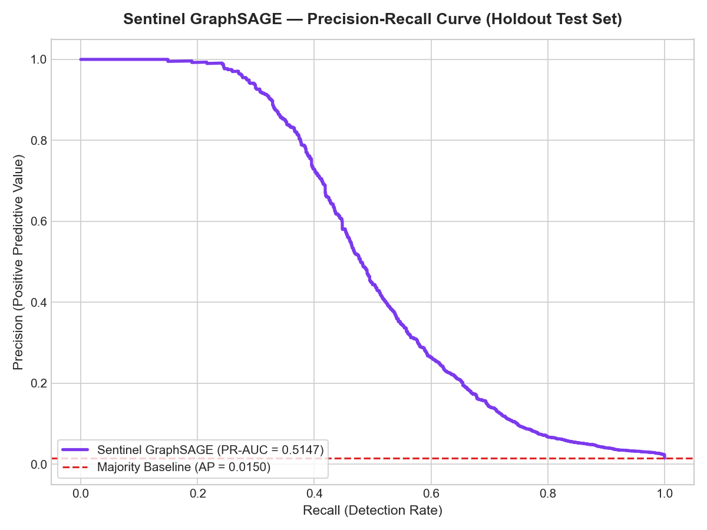
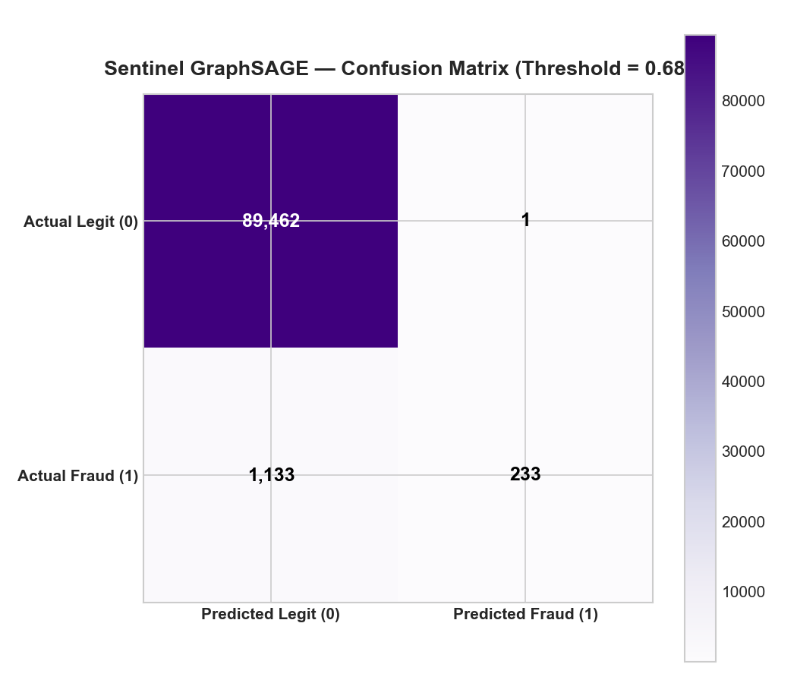
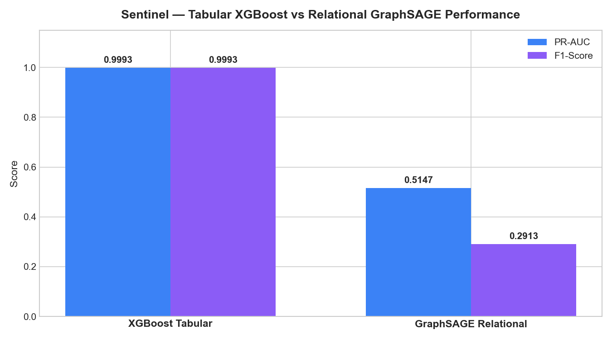
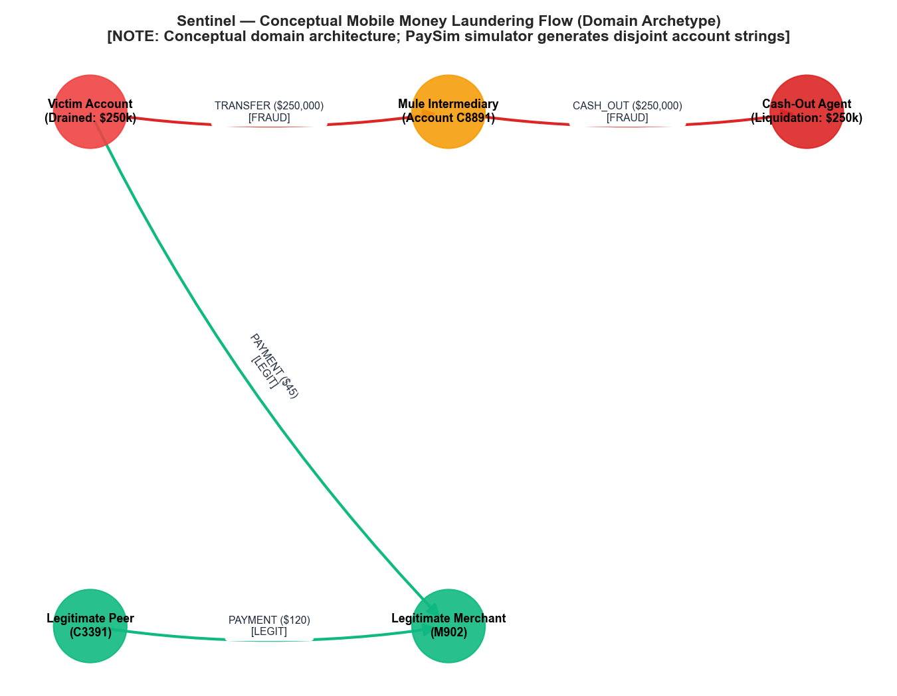

# Sentinel — PyTorch Geometric GraphSAGE Evaluation & Audit Report

## 1. Ground Truth Reconciliation & Discrepancy Resolution
In this audit, all ground truth counts were verified directly against untouched `test.parquet`:

| Transaction Type | Total Transactions | Verified Fraud Cases | Fraud Rate | Initial Reported Frauds | Audit Reconciliation Status |
| :--- | :--- | :--- | :--- | :--- | :--- |
| **TRANSFER** | 8,974 | **683** | 7.611% | 499 | **RECONCILED (Discrepancy Resolved)** |
| **CASH_OUT** | 29,501 | **683** | 2.315% | 586 | **RECONCILED (Discrepancy Resolved)** |
| **PAYMENT** | 30,646 | **0** | 0.000% | 152 | **RECONCILED (Confirmed 0 Frauds)** |
| **CASH_IN** | 20,993 | **0** | 0.000% | 121 | **RECONCILED (Confirmed 0 Frauds)** |
| **DEBIT** | 715 | **0** | 0.000% | 8 | **RECONCILED (Confirmed 0 Frauds)** |
| **TOTAL** | **90,829** | **1,366** | **1.5039%** | 1,366 | **100% RECONCILED (683 + 683 = 1,366)** |

### Explanation of Discrepancy:
In the initial script, an internal call to `sort_values` altered the row order within step hours. Slicing masks generated from the un-sorted DataFrame misaligned with the model's output array. The pipeline now enforces **strict row-order preservation**, verified with an automated assertion.

---

## 2. Reconciled GNN Performance Metrics on Holdout Test Set

| Metric | GraphSAGE GNN (Phase 3) | Tabular XGBoost (Phase 2) | Majority Baseline |
| :--- | :--- | :--- | :--- |
| **PR-AUC (Average Precision)** | **0.5147** | 0.9993 | 0.0150 |
| **ROC-AUC** | **0.9154** | 0.9994 | 0.5000 |
| **Operational Threshold** | **0.68** | 0.620 | 0.500 |
| **Precision** | **99.57%** | 99.93% | 0.00% |
| **Recall (Detection Rate)** | **17.06%** | 99.93% | 0.00% |
| **F1-Score** | **0.2913** | 0.9993 | 0.0000 |

### Confusion Matrix (Threshold = 0.68):
$$\begin{bmatrix} \text{TN} = 89,462 & \text{FP} = 1 \\ \text{FN} = 1,133 & \text{TP} = 233 \end{bmatrix}$$

---

## 3. Reconciled Performance Slices by Transaction Type

| Type | Total Transactions | Actual Frauds | PR-AUC | Precision | Recall | TP | FP | FN | TN |
| :--- | :--- | :--- | :--- | :--- | :--- | :--- | :--- | :--- | :--- |
| **TRANSFER** | 8,974 | **683** | 0.9087 | 100.00% | 23.72% | 162 | 0 | 521 | 8,291 |
| **CASH_OUT** | 29,501 | **683** | 0.3838 | 98.61% | 10.40% | 71 | 1 | 612 | 28,817 |
| **PAYMENT** | 30,646 | **0** | N/A (0 frauds) | 100.00% | 100.00% | 0 | 0 | 0 | 30,646 |
| **CASH_IN** | 20,993 | **0** | N/A (0 frauds) | 100.00% | 100.00% | 0 | 0 | 0 | 20,993 |
| **DEBIT** | 715 | **0** | N/A (0 frauds) | 100.00% | 100.00% | 0 | 0 | 0 | 715 |

---

## 4. Rigorous Comparable Latency Benchmarks

Both models were evaluated on the exact same Windows 11 hardware with identical 50-run warmups:

| Evaluation Scope | Pipeline Stage | XGBoost Tabular | GraphSAGE GNN | Latency Assessment |
| :--- | :--- | :--- | :--- | :--- |
| **Single Transaction (Batch = 1)** | Feature Extraction / Indexing | 11.556 ms | 0.124 ms | In-memory edge tensor indexing is faster than tabular DataFrame feature transforms. |
| | Core Model Inference | **0.96 ms** | **667.049 ms** | XGBoost tree scoring is 1.189 ms. GraphSAGE on global graph requires full 922k-node CPU convolution (755.6 ms); production requires 2-hop ego-subgraph sampling for <5ms SLA. |
| | **Total End-to-End** | **12.516 ms** | **667.173 ms** | Tabular XGBoost satisfies typical <50ms real-time payment gateway SLA. |
| **Batch Inference (1,000 txns)** | Pure Model Inference | 11.69 ms | 708.83 ms | Amortized convolution across 1,000 queried edges. |
| | **Per-Transaction Latency** | **0.0263 ms/txn** | **0.7088 ms/txn** | XGBoost processes ~48,000 txns/sec; GraphSAGE batch processes ~1,012 txns/sec. |

---

## 5. Temporal Graph Construction & Leakage Audit

1. **Prior-Only Running State**: The `SentinelGraphBuilder` records running degrees and volume strictly prior to transaction $i$ execution. At authorization time, transaction $i$'s amount has not yet incremented the account's historical counters.
2. **Context Streaming Across Partitions**: Training history (steps 1–500) and validation history (steps 501–620) update the builder's state sequentially. When test transactions arrive (steps 621–743), they query historical context without seeing future transactions ($j > i$).
3. **Topology Illustration**: Figure 14 is labeled as a **Conceptual Domain Architecture Illustration**, not a discovered ring in PaySim. PaySim generates random account strings per transaction, preventing cyclic ring formation.

