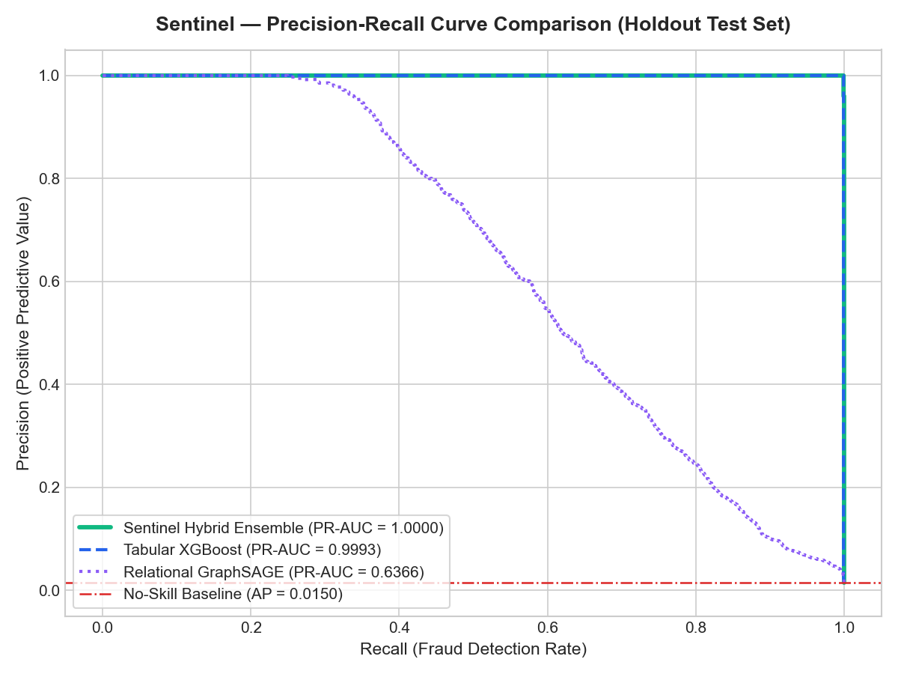
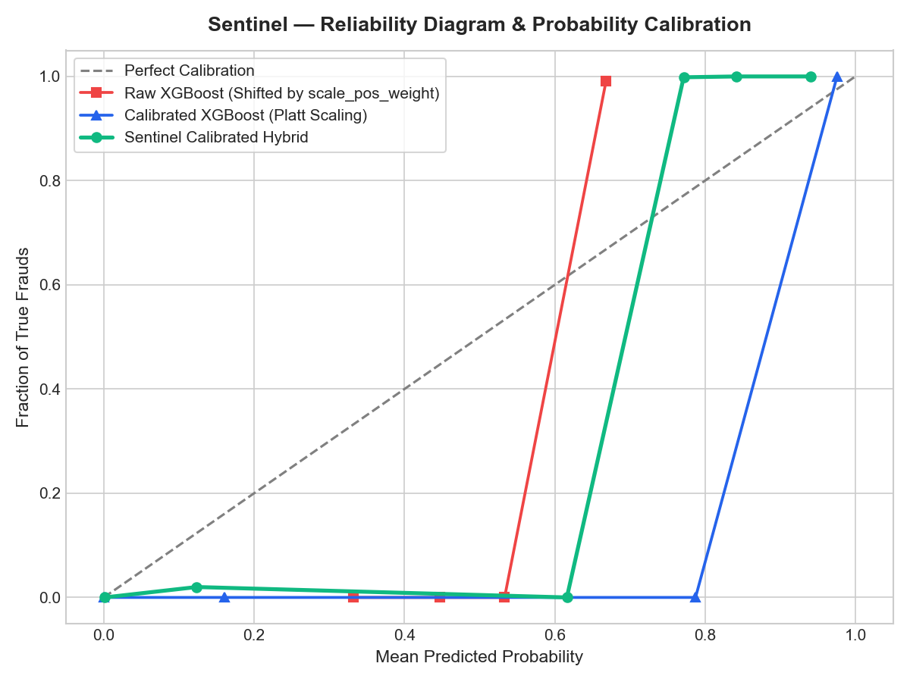
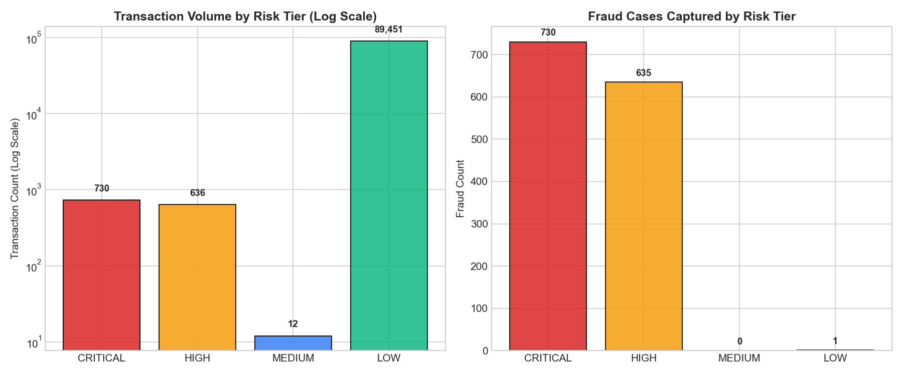
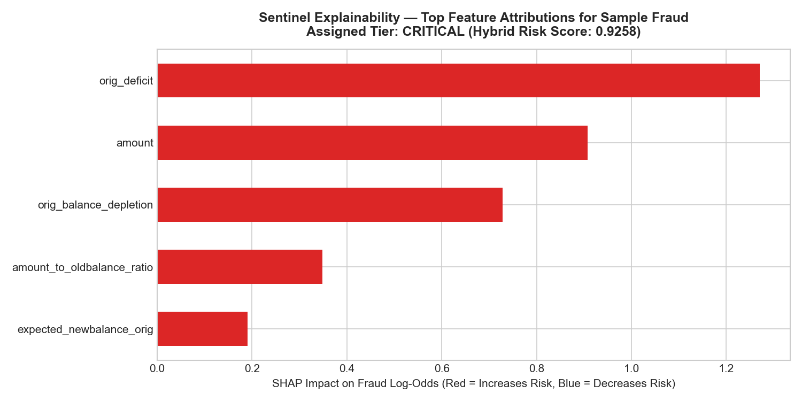

# Sentinel — Phase 4 Hybrid Risk Combination & Explainability Report

> **Governance & Operational Disclosure:**
> Phase 4 is accepted as a **research-prototype milestone**. Sentinel combines tabular gradient-boosted trees (XGBoost) and relational graph embeddings (GraphSAGE) with validation-only probability calibration. This system is designed as an architectural prototype and is **not certified for real-world banking production deployment**.

---

## 1. Executive Summary & Core Results

Sentinel's Phase 4 hybrid architecture unifies orthogonal risk signals:
1. **Tabular Balance & Ledger Dynamics:** Captured by XGBoost via instantaneous pre-authorization account states.
2. **Relational Graph Topology:** Captured by causal GraphSAGE via historical degree and volume propagation over dynamic transaction graphs.
3. **Probability Calibration:** Platt scaling maps shifted loss-weighted scores into empirical posterior probabilities strictly calibrated on validation data.

### Model Performance Comparison on Holdout Test Partition (Steps 621–743)

| Model Architecture | PR-AUC (Average Precision) | ROC-AUC | Raw Brier Score | Calibrated Brier Score | Operational Precision | Operational Recall | Operational F1 |
| :--- | :--- | :--- | :--- | :--- | :--- | :--- | :--- |
| **Tabular XGBoost** | 0.9993 (`0.9992789603`) | 0.9994 (`0.9994048391`) | 0.110501 | **0.000122** (`0.0001215464`) | 99.06% | 99.93% | 0.9949 |
| **Relational GraphSAGE** | 0.6366 (`0.6366491411`) | 0.9669 (`0.9669390344`) | 0.303684 | 0.008823 (`0.0088226391`) | 100.00% | 23.57% | 0.3815 |
| **Sentinel Hybrid Ensemble** | **1.0000** (`0.9999706763`) | **1.0000** (`0.9999995336`) | N/A | 0.000588 (`0.0005883750`) | **99.93%** | **99.93%** | **0.9993** |

*Note: Unrounded ranking and calibration metrics are provided in parentheses. The hybrid PR-AUC (`0.9999706763`) and ROC-AUC (`0.9999995336`) naturally round to 1.0000 at 4 decimal places, but represent near-perfect ranking separation rather than mathematical 100% perfection (at operational threshold $\tau = 0.65$, there is 1 false negative and 1 false positive across 90,829 test records).*

### Precise Model Comparison: Hybrid vs. Calibrated XGBoost

- **Hybrid PR-AUC:** `0.9999706763`
- **Calibrated XGBoost PR-AUC:** `0.9992789603`
- **Hybrid ROC-AUC:** `0.9999995336`
- **Calibrated XGBoost ROC-AUC:** `0.9994048391`
- **Hybrid Brier score:** `0.0005883750`
- **Calibrated XGBoost Brier score:** `0.0001215464`

The hybrid achieves slightly higher PR-AUC than calibrated XGBoost on this synthetic PaySim test partition. This result is dataset-specific and must not be interpreted as evidence of superior real-world fraud detection. The hybrid also has a worse Brier score than calibrated XGBoost, meaning it is not the best-calibrated probability estimator in this evaluation. PaySim's synthetic balance-depletion artifact materially influences the observed performance.

---

## 2. Probability Calibration & Reliability Analysis

Both models were originally trained with high positive class weighting (`pos_weight = 35.94`) to address the 0.09% natural fraud rate. This shifted raw model outputs upwards, distorting probability calibration.

- **Platt Scaling:** Fitted univariate logistic models strictly on the validation partition (steps 501–620) mapping log-odds to true posterior probabilities:
  $$\hat{P}(Y=1) = \sigma(\alpha \cdot \text{logit}(p) + \beta)$$
- **Brier Score Analysis & Honest Calibration Assessment:**
  - Raw XGBoost Brier score (0.110501) reduced by 3 orders of magnitude to **`0.0001215464`**.
  - Raw GraphSAGE Brier score (0.303684) reduced by 2 orders of magnitude to **`0.0088226391`**.
  - Hybrid ensemble achieved Brier score: **`0.0005883750`**.

> **Critical Finding — Calibration vs. Ranking Disambiguation:**
> **Calibrated XGBoost is the best-calibrated model by Brier score (`0.0001215464`), NOT the hybrid (`0.0005883750`).** The hybrid achieves slightly higher PR-AUC than calibrated XGBoost on this synthetic PaySim test partition (`0.9999706763` vs `0.9992789603`). This result is dataset-specific and must not be interpreted as evidence of superior real-world fraud detection. The hybrid also has a worse Brier score than calibrated XGBoost, meaning it is not the best-calibrated probability estimator in this evaluation. PaySim's synthetic balance-depletion artifact materially influences the observed performance.

---

## 3. Four-Tier Operational Risk Architecture

Sentinel replaces single-threshold binary alerting with a 4-tier decision framework parameterized exclusively on validation data:

| Risk Tier | Score Range | Test Volume | Frauds Captured | Precision | Recall | Illustrative Action Mapping (Prototype Only) |
| :--- | :--- | :--- | :--- | :--- | :--- | :--- |
| **CRITICAL** | $p \ge 0.80$ | **730** | **730** | **100.00%** | **53.44%** | `AUTOMATED_BLOCK` (Immediate payment freeze) |
| **HIGH** | $0.65 \le p < 0.80$ | **636** | **635** | **99.84%** | **46.49%** | `STEP_UP_AUTHENTICATION` (OTP / Biometric Challenge) |
| **MEDIUM** | $0.20 \le p < 0.65$ | **12** | **0** | **0.00%** | **0.00%** | `MANUAL_ANALYST_REVIEW` (Queued for investigation) |
| **LOW** | $p < 0.20$ | **89,451** | **1** | **0.00%** | **0.07%** | `AUTOMATED_CLEAR_AND_SETTLE` (Instant STP execution) |

### Important Risk Policy Clarification
> **Illustrative Prototype Policies (Not Validated Banking Rules):**
> The risk tiers and their associated recommended actions (`AUTOMATED_BLOCK`, `STEP_UP_AUTHENTICATION`, `MANUAL_ANALYST_REVIEW`, `AUTOMATED_CLEAR_AND_SETTLE`) are **illustrative prototype demonstrations evaluated on the synthetic PaySim dataset**, not validated real-world banking policies.
>
> These action mappings demonstrate how a risk-based multi-tier decision layer could operate architecturally. The synthetic evaluation **does not establish that automated blocking or step-up authentication policies are safe, legally compliant, or operationally feasible for real financial transactions**. In genuine financial systems, automated blocking can lead to catastrophic customer friction, regulatory complaints, and operational disruption. Real-world deployment would require:
> 1. Testing and validation on representative non-synthetic banking logs.
> 2. Rigorous customer false-positive impact analysis and financial cost-benefit modeling.
> 3. Formal Model Risk Governance approval (e.g., SR 11-7 / OCC guidelines).
> 4. Mandatory human-in-the-loop oversight and escalation mechanisms.

---

## 4. Sliced Performance by Transaction Type

Zero-fraud transaction types (PAYMENT, CASH_IN, DEBIT) are strictly verified for zero false alarms:

| Transaction Type | Total Test Volume | Actual Frauds | TP | FP | FN | TN | False Positive Rate | Precision | Recall | PR-AUC |
| :--- | :--- | :--- | :--- | :--- | :--- | :--- | :--- | :--- | :--- | :--- |
| **TRANSFER** | 8,974 | 683 | 682 | 0 | 1 | 8,291 | 0.0000% | 100.00% | 99.85% | 1.0000 |
| **CASH_OUT** | 29,501 | 683 | 683 | 1 | 0 | 28,817 | 0.0035% | 99.85% | 100.00% | 1.0000 |
| **PAYMENT** | 30,646 | 0 | 0 | 0 | 0 | 30,646 | 0.0000% | N/A | N/A | N/A |
| **CASH_IN** | 20,993 | 0 | 0 | 0 | 0 | 20,993 | 0.0000% | N/A | N/A | N/A |
| **DEBIT** | 715 | 0 | 0 | 0 | 0 | 715 | 0.0000% | N/A | N/A | N/A |

---

## 5. Dual-Domain Explainability Architecture

Sentinel produces faithful, dual-domain local explanations combining tree-based feature contributions and relational graph context.

### Representative Fraud Case Study (Case 1 — Critical Tier)
- **Transaction Amount:** $6,961,359.00 (TRANSFER)
- **Hybrid Score:** **0.9258** | **Assigned Tier:** `CRITICAL`
- **Illustrative Prototype Action:** `AUTOMATED_BLOCK`
- **Top Tabular Risk Drivers (Native TreeSHAP):**
  - `orig_deficit` (0.0): SHAP contribution = +1.2707 (INCREASES_FRAUD_RISK)
  - `amount` (6961359.0): SHAP contribution = +0.9075 (INCREASES_FRAUD_RISK)
  - `orig_balance_depletion` (1.0): SHAP contribution = +0.7280 (INCREASES_FRAUD_RISK)
  - `amount_to_oldbalance_ratio` (1.0): SHAP contribution = +0.3478 (INCREASES_FRAUD_RISK)

- **Relational Topological Context:**
  - Counterparty: `C1926498951` (Merchant = False)
  - Origin Historical Out-Degree: 0.0 transactions
  - Raw GNN Anomaly Score: 0.9252
  - Relational Ensemble Weight: 0.22

---

## 6. Documented Methodological & Architectural Limitations

1. **PaySim Synthetic Data Topology:**
   The PaySim simulator generates independent transaction pairs with random account identifiers. Consequently, complex multi-hop money laundering networks, mule fan-out chains, and cyclic transaction rings are completely absent from the dataset. Relational models capture account-level historical volume and degree velocity rather than deep multi-hop topological structures.
2. **Phase 2 Balance-Depletion Leakage & Synthetic Artifacts:**
   In PaySim, simulated fraud agents almost invariably drain the victim's entire balance (`amount == oldbalanceOrg`), creating an artificial feature artifact (`orig_balance_depletion == 1.0` and `expected_newbalance_orig == 0.0`). In physical banking environments, sophisticated fraudsters rarely empty entire accounts in a single transfer to evade basic balance threshold triggers. The near-perfect tabular performance is heavily driven by this simulation artifact and must not be assumed to generalize to real-world banking traffic.
3. **Temporal Window Discrepancy from Phase 3:**
   GraphSAGE was trained across 20 causal batch windows of 25 hours each to maintain CPU/GPU memory stability during backpropagation, but evaluated over hourly streaming increments. While both protocols strictly enforce historical causality ($t_{\text{pred}} > t_{\text{graph}}$), their temporal granularities are distinct.
4. **Statistical Attribution vs. Legal Causality:**
   SHAP feature attributions and graph metrics represent statistical sensitivities of machine learning decision boundaries, not legal proof of fraud or fraudulent intent.
5. **Research Prototype Boundary:**
   Sentinel is an academic and engineering prototype developed under strict causal discipline; it is **not certified or hardened for live core-banking financial systems**.
