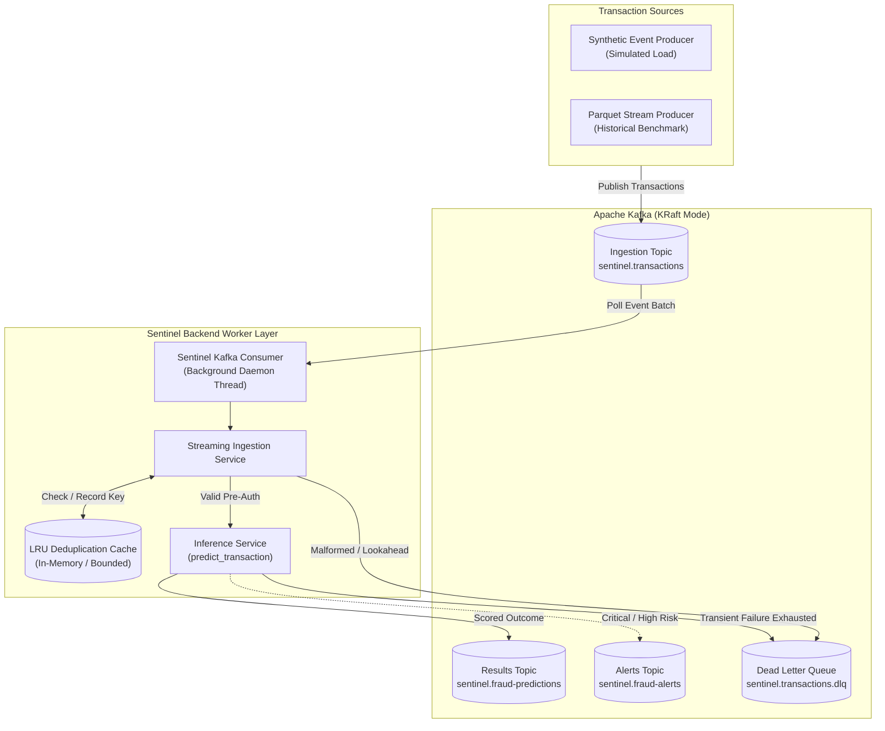

# Sentinel Phase 6: Kafka-Based Real-Time Transaction Streaming Architecture

## 1. Overview

Sentinel Phase 6 introduces an event-driven, real-time transaction streaming ingestion layer built on Apache Kafka and integrated with Sentinel's hybrid XGBoost + PyTorch Geometric GraphSAGE fraud scoring engine.



---

## 2. Delivery Semantics & Failure Recovery

### At-Least-Once Delivery with Explicit Idempotency Deduplication
* **Kafka Offsets:** Offsets are committed manually post-processing (`enable.auto.commit = False`). A message's offset is only committed after the event is successfully scored and published to `sentinel.fraud-predictions`, or safely routed to `sentinel.transactions.dlq`.
* **Deduplication:** A bounded, thread-safe LRU cache tracks `idempotency_key` (falling back to `transaction_id`). Duplicate deliveries (due to consumer rebalances or producer retries) emit a `DUPLICATE_IGNORED` outcome without re-executing model inference.
* **Non-Loss Guarantee:** In the event of an unhandled crash or process restart before offset commit, uncommitted messages will be re-delivered and deduplicated upon recovery.

### Failure Classification & Dead-Letter Queue (DLQ) Routing
| Error Condition | Retry Behavior | Destination | Outcome Status |
| :--- | :--- | :--- | :--- |
| **Corrupt JSON / Malformed Payload** | None (Non-transient) | `sentinel.transactions.dlq` (`CORRUPT_PAYLOAD`) | `REJECTED_VALIDATION` |
| **Pydantic Schema Violation** | None (Non-transient) | `sentinel.transactions.dlq` (`VALIDATION_ERROR`) | `REJECTED_VALIDATION` |
| **Temporal Lookahead Violation (`step <= 620`)** | None (Non-transient) | `sentinel.transactions.dlq` (`TEMPORAL_LOOKAHEAD_ERROR`) | `REJECTED_TEMPORAL_LOOKAHEAD` |
| **Transient Model / CUDA / Memory Error** | Exponential backoff up to `KAFKA_MAX_RETRIES` (default: 3) | `sentinel.transactions.dlq` (`RETRY_EXHAUSTED` on exhaustion) | `FAILED` |

---

## 3. Operational Safety Guarantees

1. **Disabled by Default:** `KAFKA_ENABLED=false` by default. Application startup never blocks on broker connectivity unless explicitly configured.
2. **Read-Only Scoring Non-Interference:** Streaming inference invokes `inference_service.predict_transaction()`, which is strictly read-only. It never updates historical graph degrees, adds edges, triggers settlement ledger writes, or compromises Replay (`DRY_RUN`) isolation.
3. **Causal Watermark Enforcement:** Any streamed transaction with `step <= 620` (the frozen graph snapshot cutoff) is rejected and routed to the DLQ, ensuring temporal isolation.
4. **Action vs. Settlement Separation:** Recommended actions like `AUTOMATED_CLEAR_AND_SETTLE` are decision recommendations; they never initiate automatic settlement writes.

---

## 4. Local Quickstart (Docker Compose KRaft Mode)

### Step 1: Start Local Kafka
```bash
docker compose up -d
```
Verify the broker is healthy:
```bash
docker compose ps
```

### Step 2: Configure Environment
In `.env`:
```ini
KAFKA_ENABLED=true
KAFKA_BOOTSTRAP_SERVERS=localhost:9092
KAFKA_TRANSACTIONS_TOPIC=sentinel.transactions
KAFKA_RESULTS_TOPIC=sentinel.fraud-predictions
KAFKA_ALERTS_TOPIC=sentinel.fraud-alerts
KAFKA_DLQ_TOPIC=sentinel.transactions.dlq
KAFKA_CONSUMER_GROUP=sentinel-inference-group
```

### Step 3: Start Sentinel Backend
```powershell
uvicorn backend.app.main:app --host 127.0.0.1 --port 8000 --workers 1
```

### Step 4: Stream Synthetic Transaction Events
```python
from backend.app.core.config import settings
from backend.app.workers.kafka_client import SentinelKafkaProducer
from backend.app.workers.kafka_producer import stream_synthetic_events

producer = SentinelKafkaProducer(bootstrap_servers=settings.KAFKA_BOOTSTRAP_SERVERS)
stream_synthetic_events(producer, count=50, interval_sec=0.05, step=625)
```
